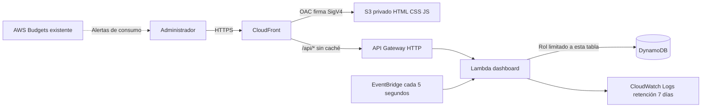

# Despliegue del dashboard DomotiX en AWS

La pila `domotix-dashboard` implementa el frontend y el CRUD completo. Es independiente de la Lambda anterior `iot-telemetry-processor` y de `TelemetryReadings`; no importa ni elimina sus registros. Los seis dispositivos de demostración se crean una sola vez al iniciar sesión por primera vez.

## Arquitectura

Los recursos IAM se limitan a las dos tablas, al bucket de publicación y a sus grupos de registros. El bucket bloquea acceso público y permite lectura exclusivamente desde la distribución. API Gateway limita peticiones a 10 por segundo y ráfagas de 20. CloudFront no almacena respuestas autenticadas en caché. La API no habilita CORS comodín: el navegador usa el mismo origen HTTPS para la página y `/api`.

## Generar y desplegar

1. Ejecutar `npm test` y `node aws/build-stack.mjs` desde el repositorio con Node.js 22.
2. El generador escribe `aws/build/cloudformation.json` y un manifiesto con hashes del frontend y backend. La carpeta está excluida de Git.
3. Subir la plantilla en CloudFormation, región `us-east-1`, nombre `domotix-dashboard`.
4. Proporcionar `AdminEmail`, `AdminSalt` y `AdminHash`. Estos dos últimos son el salt y hash scrypt de 64 bytes (hexadecimal) del usuario local, no la contraseña. No publicar estos valores en Git ni en el informe.
5. Revisar los roles y crear la pila. Esperar `CREATE_COMPLETE` y abrir `DashboardUrl` en Salidas. La publicación de los tres archivos está incluida mediante un recurso personalizado.
6. Iniciar sesión con la misma contraseña asociada al hash. El simulador genera datos cada 5 segundos; la página consulta cada 5 segundos mientras está visible. Un sensor sin datos durante 150 segundos se muestra sin señal.

La pila tiene un parámetro `SimulatorState`: `DISABLED` detiene nuevas ejecuciones programadas. Cambiarlo exige actualizar la pila. Los actuadores representan estados de demostración; no controlan hardware físico.

## Persistencia y límites de demostración

- Tabla de lecturas con claves `SensorId` y `Timestamp`, como solicita el PDF. Tabla separada con `PK` y `SK` para dispositivos, reglas, alertas, sesiones e intentos.
- Sesiones de 8 horas, cookie `Secure`, `HttpOnly` y `SameSite=Strict`; solo se almacena el hash del token. Diez intentos de inicio de sesión por IP y minuto.
- Lecturas y alertas con retención de 7 días mediante TTL. Las consultas excluyen registros vencidos aunque DynamoDB aún no los haya retirado físicamente.
- Hasta 1000 lecturas por consulta y 100 alertas visibles. Límite de demostración de 30 dispositivos y 20 reglas por sensor.
- Las escrituras relacionadas se realizan mediante transacciones y versiones. Una colisión devuelve HTTP 409 para reintentar, evitando sobrescrituras silenciosas.
- Eliminar un dispositivo requiere desactivarlo. La baja es lógica: deja de aparecer con sus reglas y alertas y no acepta ingestas nuevas. Se retiene el marcador del dispositivo y los metadatos de reglas; las lecturas y alertas expiran por TTL. No equivale a un borrado físico inmediato de todos sus datos.
- Eliminar una lectura actualiza el valor mostrado mediante la consulta de la última lectura restante.
- La eliminación de la pila conserva la tabla y el bucket mediante `Retain`, para evitar pérdida accidental de datos. Esos recursos pueden seguir consumiendo almacenamiento.

## Costos y evidencias

El modo bajo demanda de DynamoDB no garantiza costo cero. Revisar las cuotas y créditos de la cuenta y el presupuesto antes y después de las pruebas. La evidencia del 19 de noviembre muestra US$0.93 de costo acumulado, US$198.33 de créditos restantes y un correo del presupuesto pendiente de verificación. Budgets es una alerta, no un mecanismo automático de apagado.

## Verificación de entrega

No declarar completado el despliegue hasta verificar la URL pública, login, alta/consulta/edición/baja de un dispositivo, regla, telemetría, alerta y persistencia tras recargar. Guardar capturas de esas pruebas. Confirmar además la colección Postman, el correo de Budgets, las contribuciones reales de los cinco integrantes y las ramas `main` y `develop`.

Congelar código, despliegue y documento antes de las 06:30 del 21 de noviembre de 2026 (El Salvador). Registrar el commit defendido y los hashes del manifiesto; no cambiar los recursos enviados después del cierre.

## Referencias oficiales

- [Funciones Lambda en CloudFormation](https://docs.aws.amazon.com/AWSCloudFormation/latest/TemplateReference/aws-resource-lambda-function.html)
- [Acceso privado de CloudFront a S3 mediante OAC](https://docs.aws.amazon.com/AmazonCloudFront/latest/DeveloperGuide/private-content-restricting-access-to-s3.html)

El disparador EventBridge sigue ejecutándose cada minuto. Cada invocación Lambda realiza 12 rondas con cadencia aproximada de 5 segundos durante 55 segundos; el tiempo límite es 90 segundos. El horario de EventBridge puede introducir variación entre invocaciones. Esta implementación consume tiempo de Lambda mientras espera entre rondas.
